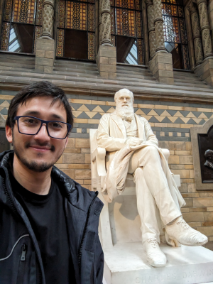

<!-- Background Header Section - 30vh -->
::: {.column-screen style="background-image: linear-gradient(to bottom, transparent 60%, white 100%), url('../img/paisaje.jpg'); background-size: cover; background-repeat: no-repeat; background-attachment: scroll; background-position-x: center; background-position-y: top; height: 40vh; margin-top: -60px; display: flex; align-items: center; justify-content: center; flex-direction: column;"}
{style="width: 200px; height: 200px; object-fit: cover; border-radius: 50%; border: 4px solid white; box-shadow: 0 8px 25px rgba(0,0,0,0.3); margin-top: 60px;" alt="George G. Vega Yon 博士与大英博物馆查尔斯·达尔文雕像"}
:::

::: {.home-hero}
# George G. Vega Yon, Ph.D.

[研究副教授 · 犹他大学流行病学系]{.home-hero-role}
:::

::: {.home-lead}

人与人之间的连结如何塑造行为、健康与疾病的传播？我的研究开发统计与计算方法来探讨这些问题。

我是一名方法学研究者，工作于网络科学、[统计计算](https://en.wikipedia.org/w/index.php?title=Computational_statistics&oldid=1340808080){target="_blank"}与[复杂系统](https://en.wikipedia.org/w/index.php?title=Complex_system&oldid=1369270950){target="_blank"}的交会之处。我研究社会网络、社会影响与疾病传播，尤其专精于指数族随机图模型（ERGM）、模拟，以及机理式——即[理论驱动](https://doi.org/10.1098/rsbl.2017.0660){target="_blank"}——的机器学习。这些应用刻意保持跨学科，涵盖[流行病学与疫情建模、犯罪学、行为的社会传播，以及基因功能的演化](research.qmd)。

工具开发是我工作的核心。我为统计推论、高性能计算与模拟建构[科学软件](software.qmd)，将复杂的方法转化为其他研究者可以信赖的工具。近年来，我致力于让复杂模型能为专业人士以外的受众所用，例如在近期美国麻疹疫情期间建构的互动式公众[麻疹模拟器](https://ggvy.cl/shiny/measles){target="_blank"}。

我是[犹他大学流行病学系](https://medicine.utah.edu/internalmedicine/epidemiology/){target="_blank"}的研究副教授，同时在人口健康科学系及 Kahlert 计算学院担任兼职教职。我的跨学科训练涵盖公共政策（硕士，[UAI](https://www.uai.cl/){target="_blank"}）、经济学（理学硕士，[Caltech](https://caltech.edu){target="_blank"}）与生物统计学（博士，[USC](https://usc.edu){target="_blank"}）。
:::

::: {.home-links}
<a href="../cv/cv.pdf" title="学术履历（PDF）" aria-label="学术履历（PDF）"><i class="bi bi-file-earmark-person" aria-hidden="true"></i></a>
<a href="https://scholar.google.com/citations?user=34E1yTAAAAAJ&hl=en" target="_blank" title="Google Scholar 个人档案" aria-label="Google Scholar 个人档案"><i class="bi bi-mortarboard-fill" aria-hidden="true"></i></a>
<!-- ORCID 是唯一没有 Bootstrap Icons 字符的标志，因此以 SVG 内嵌。 -->
<a href="https://orcid.org/0000-0002-3171-0844" target="_blank" title="ORCID 个人档案" aria-label="ORCID 个人档案"><svg viewBox="0 0 24 24" aria-hidden="true" focusable="false"><path d="M12 0C5.372 0 0 5.372 0 12s5.372 12 12 12 12-5.372 12-12S18.628 0 12 0zM7.369 4.378c.525 0 .947.431.947.947s-.422.947-.947.947a.95.95 0 0 1-.947-.947c0-.525.422-.947.947-.947zm-.722 3.038h1.444v10.041H6.647V7.416zm3.562 0h3.9c3.712 0 5.344 2.653 5.344 5.025 0 2.578-2.016 5.025-5.325 5.025h-3.919V7.416zm1.444 1.303v7.444h2.297c3.272 0 4.022-2.484 4.022-3.722 0-2.016-1.284-3.722-4.097-3.722h-2.222z"/></svg></a>
<a href="https://github.com/gvegayon" target="_blank" title="GitHub 上的代码" aria-label="GitHub 上的代码"><i class="bi bi-github" aria-hidden="true"></i></a>
<a href="https://linkedin.com/in/georgevegayon" target="_blank" title="LinkedIn 个人档案" aria-label="LinkedIn 个人档案"><i class="bi bi-linkedin" aria-hidden="true"></i></a>
<a href="https://bsky.app/profile/gvegayon.bsky.social" target="_blank" title="Bluesky" aria-label="Bluesky"><i class="bi bi-bluesky" aria-hidden="true"></i></a>
:::

---

::: {style="font-size: 0.9em; color: #666; text-align: center; margin-top: 2em; padding: 1em; background-color: #f8f9fa; border-radius: 5px;"}
*本网站版本使用 GitHub Copilot 从原始英文版本自动翻译，尚未经过人工验证。*
:::
